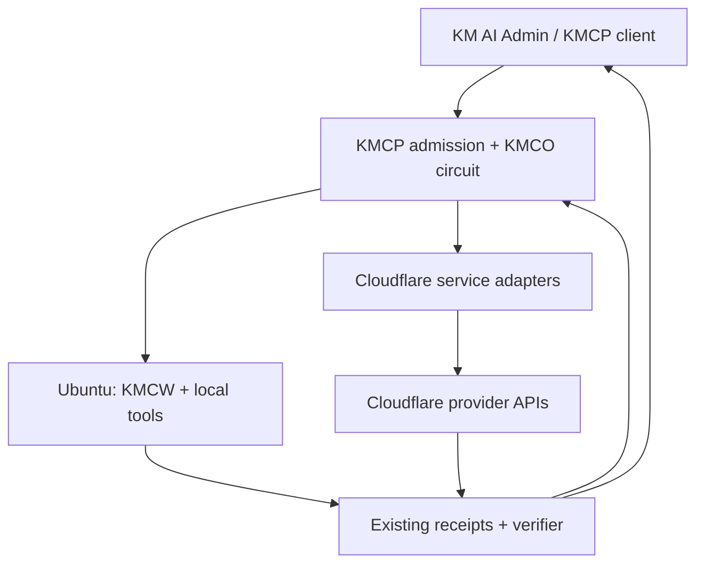

# KMCP / KMCO — แบบส่วนจัดการ Cloudflare ทั้งระบบ V1

Mission: `KMCP-V5-PRODUCTION`  
Work package: Cloudflare service adapters + Ubuntu node integration  
วันที่: 22 พฤศจิกายน 2026 (Asia/Bangkok)  
สถานะ: **DESIGN_RECORDED / ADAPTER_IMPLEMENTATION_PENDING / LIVE_ACCOUNT_INVENTORY_NOT_READ**  
เอกสารนี้เป็นแบบขยายระบบเดิม ไม่ใช่หลักฐานว่า deploy หรือควบคุมทุกบริการได้แล้ว

## 1. Reality / Assumption

### หลักฐานที่อ่านแล้ว

- KnowingMindDashboard PR #6 head `9c8cb7539e9a7044135ec2281207ed9f090e0156`: มีตัวติดตั้ง host, Worker edge และเครื่องมือวงจร KMCP
- `av15/coding_worker_v2/agent/tools.py`: ToolSpec, ToolRegistry, input/output contract, permissions, audit และ opt-in circuits / KMCO
- `agent/kmco_runtime.py`: catalog 132 operations / 24 groups เป็น design; describe คืน callable=false; dispatch_readonly รับเฉพาะ read handlers ที่ผ่าน binding/authority; ไม่ใช่ Cloudflare write adapter
- `agent/circuits.py`: วงจร KMCP ใช้ execution/checkpoint/receipt เดิม; ไม่ได้ทำให้บริการภายนอกได้รับสิทธิ์อัตโนมัติ
- KnowingMindApp `docs/control/CONTROL_PLANE_SPINE_V1.md`: มี topology, capability, pipeline และ environment registries เดิม; ห้ามสร้างฐานทะเบียน/heartbeat/observability ซ้อน
- KnowingMindApp `config/runtime/ENVIRONMENT_CONTRACT_V1.json`: มี canonical secret/config names; GitHub เก็บ references ไม่เก็บค่า secrets; D1 ไม่ใช่ Dhamma project truth
- KnowingMindApp มี source Workers เดิม `cloudflare_workers/knowingmind-line-webhook` และ `apps/dhamma-web-channel-edge` จากการอ่าน source ในงานติดตั้งก่อนหน้า; ยังไม่ยืนยัน deployment ปัจจุบันของบัญชี
- เอกสารเก่ามี SG2/KCC; ไม่ใช้เป็นเส้นทางใหม่ ไม่เปิดกลับมาแทน KM AI Admin / KMCP
- ภาพเจ้าของเวลา 17:36 แสดง tools install complete, Node archive checksum OK และ gh auth login หยุดเลือก HTTPS/SSH; ยังไม่แสดง runner online
- ไม่ได้อ่าน live Cloudflare account inventory, account ID, entitlement, current bindings หรือ token scopes ในงานออกแบบนี้

### สิ่งที่ยังต้องผูกจากของจริง

ชื่อ Worker/API ของ KM AI Admin ที่รับ control ปัจจุบัน, D1 operational writer/binding ที่ได้รับอนุมัติจริง,
existing queue/lease interface, resource IDs, host runner registration, KMCP origin authentication
และ mapping KMCO operation ID → Cloudflare handler ยังเป็น PENDING ห้ามเดาค่าแทน

## 2. เป้าหมายและเกณฑ์จบ

ให้เจ้าของจัดการ Cloudflare ผ่าน KM AI Admin เดิม หรือส่งคำสั่ง KMCP แล้วประกอบเป็นวงจร KMCO
ที่มี input/output, สิทธิ์, resource target, ผลลัพธ์, receipt และการตรวจกลับครบ

ต้องแสดง 4 มิติแยกกัน:
1. service_catalog_coverage: หมวดบริการใน API catalog ถูกจำแนกครบหรือไม่
2. account_inventory_coverage: บริการ/ทรัพยากรที่บัญชีนี้มีถูกอ่านครบหรือไม่
3. adapter_coverage: มี handler ที่ทดสอบแล้วสำหรับ action ใด
4. live_acceptance_coverage: target/action ใดผ่านงานจริงและ independent QC แล้ว

ห้ามใช้จำนวน product ในเมนูหรือจำนวน design micro-ops เป็นเปอร์เซ็นต์ใช้งานจริง
บริการที่ API ไม่เปิด, ไม่มีสิทธิ์ หรือบัญชีไม่รองรับ ต้องแสดงข้อจำกัดตรง ๆ

## 3. วางในระบบเดิม



- KM AI Admin: หน้าควบคุมในระบบเดิม เพิ่ม section/tab Cloudflare ไม่ตั้ง dashboard/controller แยก
- KEBUNATE Core: เป้าหมาย ขอบเขต policy และข้อยกเว้น
- KMCO: คำอธิบายหน่วยงาน พอร์ต ความสัมพันธ์ และเส้นทางวงจร
- KMCP: admission, ACL, manifest binding และเรียก ToolRegistry เดิม
- Cloudflare adapters: ตัวแปลง action ที่มีชนิดแน่นอนเป็น official API/SDK/Wrangler
- KMCW: เตรียม source, ทดสอบ, build และ deploy artifact ที่ได้รับอนุญาต
- Ubuntu agent: endpoint ที่จำกัดคำสั่ง systemd/service/workspace ไม่รับ arbitrary shell
- GitHub runner: ช่องทาง CI/job execution สำหรับ trusted workflows ไม่ใช่เครื่องมือ remote root ทั่วไป

## 4. Source / State / Authority

| ข้อมูล | ที่เป็นหลัก | สิ่งที่อีกฝั่งเก็บ |
|---|---|---|
| Source, desired config, adapter/schema, circuit template | GitHub repo เดิม | commit SHA / artifact digest |
| Cloudflare actual resource configuration | official provider readback | observed_at, provider request ID, digest |
| KMCP circuit run บน host | QueueStore/checkpoint/receipts เดิม | projection + reference |
| Operational routing / node lease | existing approved KEBUNATE operational writer | ใช้ binding เดิมหลัง verify; ไม่สร้าง DB ใหม่ |
| Dhamma project truth | authority route เดิมที่กำหนด PostgreSQL + pgvector | Cloudflare ไม่ได้รับการย้าย authority จากแบบนี้ |
| Large evidence/build objects | existing approved artifact / R2 store | checksum + URI + retention metadata |
| Human-readable architecture | เอกสารและหน้าควบคุมเดิม | link ไป source/evidence |

ห้ามทำ bidirectional last-write-wins ระหว่าง GitHub / D1 / Ubuntu
หนึ่ง entity มีเจ้าของการเขียนเพียงหนึ่งราย; projection ระบุ source_version และความสด
ถ้ายัง map schema/writer เดิมไม่ได้ ให้หยุดก่อนเขียน ไม่สร้างตาราง/ฐานข้อมูลคู่ขนานเพื่อให้ demo ผ่าน
Cloudflare API ตอบสำเร็จเป็น operational evidence ไม่ใช่การรับรอง project truth หรือ independent QC

## 5. ขอบเขตบริการ — catalog ขยายได้

แต่ละแถวเป็นหมวด adapter ที่ออกแบบ ไม่ได้หมายถึงบัญชีมีบริการนั้นหรือมี implementation แล้ว

| หมวด | บริการที่ครอบคลุมเมื่อบัญชีมี | Actions ที่ควรจัดชนิด |
|---|---|---|
| Account | accounts, zones, members, entitlements | inventory / inspect / permission readback |
| DNS / Domain | DNS records, registrar, domains | desired diff / bounded record update / verify; registrar ตาม API ที่รองรับ |
| TLS | certificates, SSL settings, origin certificates | inspect / expiry / approved renewal/rotation |
| Edge traffic | routes, cache, redirects, rulesets, load balancing | plan / apply scoped config / purge bounded target / canary |
| Security | WAF, DDoS, Bot, API Shield | inspect / staged rules / verified policy change |
| Zero Trust | Access apps/policies, service identity, Gateway, WARP | inspect / bounded policy change / connectivity verification |
| Tunnel | cloudflared connectors, ingress, private routes | reuse tunnel / health / host-service repair / exact route readback |
| Workers / Pages | scripts, versions, deployments, routes, bindings, Builds | build / preview / deploy exact digest / verify / provider-supported rollback |
| Platform Workers | Workers for Platforms, dispatch-related services | inspect and qualified tenant lifecycle only when needed |
| Containers | images, deployments, instances | HTTP app build/deploy / readiness / lifecycle; no persistent VM claim |
| Durable Objects | namespaces, bindings, migrations | inspect / reviewed migration / metrics; storage edits separately governed |
| Workflows | instances, events, execution state | inspect / start bounded child job / pause-resume/cancel if supported |
| Queues | queues, consumers, retries, DLQ, pull delivery | inspect / reconcile / bounded retry / consumer change |
| Storage | D1, R2, KV | metadata / binding / backup evidence / governed data operations |
| Database networking | Hyperdrive and supported database connections | inspect / connection test / scoped config |
| AI | Workers AI, AI Gateway, Vectorize | model discovery / bounded inference / cost and route policy / governed index updates |
| Browser | Browser Run / Browser Rendering | bounded browser tasks with timeout and budget; explicit resource effects |
| Media | Images, Stream, media/realtime products | inspect / approved transformation / upload / delivery test |
| Email | Email Routing, Email Service, Email Security where exposed | inspect / scoped routing; send only under an explicit message contract |
| App protections | Turnstile, Web Analytics, Zaraz | inspect / scoped config / privacy policy checks |
| Network | VPC, Spectrum, Magic/WAN and other account-enabled products | API-discovered adapters; no assumption of entitlement |
| Observability | logs, analytics, audit, traces, alerts, notifications | bounded query / redaction / evidence / useful alert |
| Usage / Billing | usage, subscription, quotas, invoices | read/report; price/plan changes outside auto-remediation |

Discover additional services from a **pinned official API catalog snapshot** and account inventory.
Unknown product becomes CATALOG_ONLY / UNSUPPORTED, never arbitrary HTTP pass-through.
A catalog diff proposes adapter work; it must not automatically add a writable tool.
Some services require APIs other than the account REST catalog or dashboard-only actions.
Record API_UNAVAILABLE / ENTITLEMENT_REQUIRED / PERMISSION_DENIED separately.
A failed 403/404 read is not proof that there are zero resources.

## 6. Adapter contract and tool surface — proposed, not registered

Extend the existing ToolRegistry through an opt-in module such as
`av15/coding_worker_v2/agent/cloudflare_tools.py` (proposed path, not current implementation).
Do not create another MCP server. Keep provider implementations behind typed action allowlists.

Proposed entry points:
- `cf.catalog.read`: supported service/action/schema versions; no account secrets
- `cf.inventory.read`: account/zone-scoped, paginated, bounded read with per-service outcomes
- `cf.resource.read`: exact resource metadata/config, redacted
- `cf.change.plan`: desired vs observed diff, dependency impact, risk, cost estimate confidence
- `cf.change.apply`: exact approved plan hash + fresh preconditions + qualified backend
- `cf.change.verify`: exact provider readback and declared canary; result is not self-certified independent QC
- `cf.change.compensate`: separately authorized provider-specific compensation, never generic destructive undo
- `cf.usage.read`: usage/quota/invoice evidence; unavailable billed data stays UNKNOWN

Read tools may still reveal sensitive information: default to metadata; data-content reads require separate scope.
For D1, POST requests may perform writes: classify semantic SQL/action, never classify permission by HTTP verb alone.
No generic `cf.request(url,method,body)` tool, arbitrary SQL, arbitrary shell or unrestricted token creator.

Common action input:
```json
{
  "mission_id": "KMCP-V5-PRODUCTION",
  "task_id": "<existing-task-id>",
  "circuit_id": "<existing-circuit-id>",
  "step_id": "<step-id>",
  "account_ref": "<verified-account-binding>",
  "zone_ref": null,
  "service": "workers",
  "action": "deployment.apply",
  "resource_ref": "<verified-existing-worker>",
  "source_sha": "<exact-commit>",
  "artifact_sha256": "<exact-build-digest>",
  "expected_observed_hash": "<fresh-precondition-hash>",
  "plan_sha256": "<reviewed-plan-hash>",
  "idempotency_key": "<stable-step-key>",
  "deadline": "<UTC-timestamp>",
  "budget_ref": "<approved-budget-policy>",
  "credential_ref": "<existing-secret-binding-reference>"
}
```

credential_ref is a locator only; it confers no authority. Credentials are injected by the trusted runtime.
Common output: status, target/ref, observed_before/after hashes, provider_request_id,
action_semantics, retryability, mutation_outcome, usage_evidence, evidence_refs and next_action.
Error examples: AUTH_REQUIRED, SCOPE_DENIED, PRECONDITION_FAILED, QUOTA_BLOCKED,
RATE_LIMITED, NODE_OFFLINE, OUTCOME_UNKNOWN, API_UNSUPPORTED, ENTITLEMENT_REQUIRED.

## 7. ทำให้ KMCO ต่อเป็นวงจรได้

Mapping หนึ่งรายการต้องมี:
operation_id จาก catalog ที่ pin แล้ว, source digest, handler tool, input_schema,
output_schema, required_permissions, provider scope, side_effects, limits,
preconditions, postconditions, verifier_ref, compensation contract และ test evidence

ห้ามเพิ่มชื่อ Cloudflare ลงใน 132 catalog แล้วนับว่ามี runtime แล้ว
ต้องเลือก operation เดิมที่ตรงความหมายจาก source; ถ้าไม่มี จึงเสนอ catalog version extension
ไม่เดาหมายเลข Pxx-Mxx / Dxx-Mxx และไม่ทำให้ขอบเขต `dispatch_readonly` กลายเป็น write

Read-only KMCO bindings ใช้ช่องเดิมได้เมื่อ handler qualified
วงจร deploy/write ใช้ `kmcp.circuit.*` กับ original ToolRegistry admission/approval ของแต่ละ child
จนกว่าจะมี write dispatcher ที่ผ่านการตรวจและรับรองแยก
Manifest hash ต้องครอบ exact account/resource, action, source artifact, policy version และ ports
เปลี่ยน graph/target/artifact ต้องเปลี่ยน manifest และทบทวน authority ตาม policy

Ports ตัวอย่าง:
inventory.resources → select.target → snapshot.observed_hash → plan.plan_hash
→ apply.provider_request_id → verify.observed_hash → receipt.evidence_ref

ทุก edge มีชนิด schema และ reference ที่ตรวจได้ก่อนเกิด side effect
Controller ติดตามสถานะจาก receipt จริง ไม่ใช้ข้อความ AI ว่า “เรียบร้อย” เป็นผลลัพธ์

## 8. วงจรควบคุมหลัก

### C1 — Inventory / drift (เริ่มจาก read-only)
trigger/approved request → bounded inventory → normalize → compare desired source
→ classify drift → bounded evidence receipt → update existing Admin projection

ใช้ cache TTL ตาม resource; ไม่สแกนทุกบริการทุกครั้ง
incomplete pagination/permission must retain UNKNOWN, not turn into an empty inventory

### C2 — Worker deploy
exact source/artifact → tests/bundle → target snapshot → diff and impact
→ existing scoped admission → deploy → deployment readback
→ authenticated MCP initialize/tools-read canary → independent verifier → report

functional execution completion กับ independent QC อยู่คนละ field
health 200 ไม่พิสูจน์ MCP usable; access login สำเร็จไม่พิสูจน์ write permission
rollback Worker code ไม่รับประกันย้อน schema, data, bindings หรือ external side effects

### C3 — Ubuntu maintenance
authenticated node observation → approved service action → systemd result
→ localhost health → existing Tunnel/Access reachability → original MCP contract check
→ receipt → independent verifier

Runner มี outbound GitHub channel; cloudflared มี outbound Cloudflare channel
reuse current tunnel / loopback service / Access policy; ไม่ต้องเปิด inbound shell port
Agent ใช้ explicit unit/workspace allowlist, least local privileges และ scoped commands
ไม่ให้ Worker ใช้ root shell หรือส่ง credentials ผ่าน task JSON

### C4 — Container onboarding
verified HTTP adapter → reviewed image build → pinned image digest
→ platform entitlement/quota → persistent-state design
→ scoped deployment → readiness → authenticated functional canary → receipt/QC

ปัจจุบัน KMCP Dockerfile เป็น stdio CLI; C4 ยัง BLOCKED_HTTP_ADAPTER_REQUIRED
ไม่ย้าย QueueStore ไป ephemeral Container disk และไม่อ้างว่า auto-scale ได้โดยไม่มี shared-state fencing

### C5 — Incident repair
observe failure → classify concrete cause → select approved runbook
→ impact/budget precondition → one bounded repair → exact verify
→ recovered receipt หรือ exception พร้อม first_failure_point

no blind retry; retry reads/transient safe operations under budget
mutation timeout → OUTCOME_UNKNOWN → provider reconciliation ก่อนคิดจะส่งซ้ำ
ไม่มีทั่วไป “retry แล้วสำเร็จ”; unreconciled writes cannot be replayed automatically

## 9. Retry / concurrency / ownership

- หนึ่ง run มี scheduler/transition owner เดียว และหนึ่ง resource mutation มี fenced owner
- Phase แรกใช้ existing KMCP circuit engine + QueueStore บน Ubuntu
- Queues เป็น delivery transport, ไม่ใช่ authoritative project/run state; ใช้ stable idempotency key
- Queue delivery ซ้ำหรือ heartbeat เก่า ต้องไม่สร้าง deployment ซ้ำ
- Provider APIs ที่ไม่มี idempotency guarantee ต้องใช้ reconciliation; lock อย่างเดียวไม่ทำให้ exactly-once
- หลัง lease หมด worker เก่าต้องถูก fenced ก่อนเขียน/รายงาน commit ผล
- วงจรที่ค้างหลัง restart ต้อง reuse completed receipts; unknown step ต้อง reconcile
- retry จำกัดจำนวน/เวลา, exponential backoff + jitter, respect Retry-After, แยก quota กับ auth failures
- การชดเชยเป็นอีก action ที่มีแผนและสิทธิ์ ไม่รับประกัน rollback universal

Workflows ใช้เป็น durable driver ของ delegated cloud job ได้ใน phase ต่อไป
แต่ต้องมี accepted owner contract และ mapping ไปสถานะหลักเดิม
ไม่ให้ Workflows และ host `circuit.run` execute step เดียวกันพร้อมกัน
Workflows step retry ไม่ได้ทำให้ external provider mutation exactly-once
หากจะย้าย scheduler owner ขึ้น cloud ต้องมี state-store adapter/conformance tests และ cutover แบบหนึ่งเจ้าของ
ไม่รัน Python filesystem/QueueStore เดิมตรง ๆ ใน ordinary Workers

## 10. Ubuntu ปิดแล้วอะไรยังทำงาน

- Existing deployed Workers/Pages และ native cloud services ทำงานตาม deployment ของตนต่อได้
- GitHub-hosted CI ไม่ต้องรอ Ubuntu ถ้างานไม่ต้องใช้ hardware/runtime บน host
- Self-hosted runner และ local MCP/KMCW ไม่รับงานขณะ Ubuntu ปิด
- Phase แรก: วงจรที่ owner อยู่บน Ubuntu รอ NODE_OFFLINE; cloud edge health ไม่กลบสถานะนี้
- Phase ต่อไป: cloud-only child jobs ทำงานผ่าน approved provider-native driver ได้เมื่อ adapter พร้อม
- งานที่ต้องใช้ local files/model/GUI ต้องรอ host กลับมา ไม่มีการอ้างว่าทำแทนได้บน Worker
- ทดสอบ disconnect/reconnect/resume โดยไม่ทำ mutation ซ้ำ ก่อนประกาศ autonomous 24/7

## 11. Permission / secrets / budget

ใช้ permission groups จาก official current API ตาม account/zone/resource ที่รองรับ
แยก inventory identity, deployment identity, DNS/Tunnel identity และ secrets-administration identity
ไม่ใช้ Global API Key หรือ token เดียวให้ AI คุมบัญชีทั้งหมด
ขอบเขต resource ที่ provider token บังคับไม่ได้ ต้องมี server-side resource allowlist เพิ่มและบอกข้อจำกัด
token scope ไม่เท่ากับ entitlement, Access service token ไม่เท่ากับ Cloudflare management API token
gh login ไม่เท่ากับ Cloudflare login และ runner registration ไม่เท่ากับ production deployment approval

Reuse canonical environment names and approved native secret stores from the existing contract.
Host service credentials use the approved OS/service store; GitHub CI uses repository/environment secrets;
Worker secrets use provider-native bindings. Secret values never enter catalog/graphs/GitHub/Drive/logs.
Do not invent an environment variable alias or create another global plaintext secret file.
Redact request/response bodies, auth headers, URLs containing secrets and sensitive resource content.

Pre-authorized bounded maintenance/deploy may run automatically under an owner-approved standing policy.
Policy changes, permission escalation, destructive data actions and new spend beyond budget are exceptions.
Budget enforcement is preflight + bounded execution, not a claim of perfect instantaneous billing data.
Separate estimated_cost / metered_usage / billed_cost; UNKNOWN billed data never becomes zero.

## 12. Existing Admin / KVES integration

ใน KM AI Admin เดิมเพิ่ม view:
- Resources: account/zone/service/resource, discovered status, observation age, adapter level
- Circuits: graph/ports, policy, task owner, source/manifest hash, checkpoints and blocked step
- Nodes: Ubuntu identity, heartbeat age, runner online, service/model availability
- Changes: desired diff, exact target, budget, accepted scope, deploy/readback status
- Evidence: receipt refs, provider request IDs, independent QC and runtime/source separation

KVES ใช้ tool schemas/ports และ KMCO mapping ชุดเดียวกันเพื่อ drag/connect
ยังไม่เพิ่ม graph compiler/registry อีกชุดหนึ่ง; visual editor ส่ง manifest เดียวกับ CLI
กล่องสีเขียวต้องอิงสถานะจริง; DESIGN_ONLY และ REGISTERED ห้าม render เป็น LIVE_VERIFIED

## 13. งานถัดไป / เจ้าของ / acceptance

| Task | Owner Node | Input | Output / acceptance | Status / evidence | Next action |
|---|---|---|---|---|---|
| T0 Runner online | Ubuntu owner + GitHub | tools installed, gh login | exact runner online + one trusted job receipt | LOGIN_PENDING จากภาพ | finish login, run installer |
| T1 Existing authority binding | KM AI Admin / KMCP maintainer | current endpoint + canonical registries | exact writer/lease/secret references, no duplicate registry | PENDING | bind current approved route |
| T2 Read-only CF adapters | KMCW / GitHub-hosted CI | API snapshot + schema + scope refs | inventory/resource read, per-service errors, pagination tests | DESIGN_ONLY | implement opt-in typed read tools |
| T3 One live service | Cloudflare runtime + verifier | existing Worker, scoped credential | read inventory + one bounded approved canary + receipt/QC | PENDING_LIVE_ACCOUNT | target first existing Worker |
| T4 KMCO circuits | KMCP/KMCO | pinned op mapping + qualified handler | typed drift and deploy circuits, restart/idempotency tests | DESIGN_ONLY | bind read circuit first |
| T5 Ubuntu bridge | Ubuntu + existing edge/Access | allowed units, authenticated route | service health/repair canary + reconnect receipt | DESIGN_ONLY | reuse original node channel |
| T6 Remaining services | same adapters + service owners | coverage gaps + approved scope | product/action-specific live acceptance | NOT_STARTED | expand by exact capability gap |
| T7 Cloud-only continuity | approved native cloud driver | ownership/state-store contract | host-off canary, no duplicate step or authority | DESIGN_ONLY | qualify delegated cloud jobs |

Stop condition for T0: runner online **and** one trusted selected job completes; local service active alone is insufficient.
Stop condition for full management: every account-used resource has an inventory outcome and every enabled
write action has a typed qualified adapter, exact authorization and real acceptance evidence.
Products not used/unsupported are explicitly classified rather than creating resources to raise a score.
No repeated full audit once evidence remains fresh; re-check only expiry, config/source change or failed acceptance.

## 14. ขั้นตอนหน้าจอปัจจุบัน

เลือก HTTPS → Enter → ยืนยันการ authenticate Git ด้วยบัญชี GitHub → Login with a web browser
→ ใช้ device code เฉพาะในหน้า GitHub → จนกลับ terminal และรายงานบัญชีที่ล็อกอินสำเร็จ

จากนั้นใน checkout เดิม:
```bash
cd "$HOME/kmcp-host-setup"
export PATH="$HOME/.local/bin:$PATH"
bash scripts/host/install-runner.sh
```

ถ้า auth flow จบแล้วและคำสั่ง installer ในชุดเดิมทำต่อเอง ให้รอผล ไม่เปิดชุดติดตั้งซ้อน
หาก installer หยุดที่ persistent-storage error ให้ตั้ง RUNNER_DIR ไปที่ filesystem ถาวรจริง
โดยไม่ format หรือเดา mount path
ไม่ต้อง clone ใหม่หรือรัน install-tools ซ้ำ

## 15. References

Source pins:
- https://github.com/siango/KnowingMindDashboard/pull/6
- https://github.com/siango/KnowingMindDashboard/blob/9c8cb7539e9a7044135ec2281207ed9f090e0156/av15/coding_worker_v2/agent/tools.py
- https://github.com/siango/KnowingMindDashboard/blob/9c8cb7539e9a7044135ec2281207ed9f090e0156/av15/coding_worker_v2/agent/kmco_runtime.py
- https://github.com/siango/KnowingMindApp/blob/711c4bd642e19d2cef52fcf7bc1fa667c5bd0e91/docs/control/CONTROL_PLANE_SPINE_V1.md
- https://github.com/siango/KnowingMindApp/blob/711c4bd642e19d2cef52fcf7bc1fa667c5bd0e91/config/runtime/ENVIRONMENT_CONTRACT_V1.json
- https://github.com/siango/KnowingMindApp/blob/711c4bd642e19d2cef52fcf7bc1fa667c5bd0e91/docs/topology/CAPABILITY_REGISTRY_V1.json

Official Cloudflare docs checked on 2026-11-22:
- https://developers.cloudflare.com/api/ — service/resource API catalog
- https://developers.cloudflare.com/fundamentals/api/reference/permissions/ — permission groups and resource scopes
- https://developers.cloudflare.com/workflows/ — durable step execution and event waiting
- https://developers.cloudflare.com/queues/reference/delivery-guarantees/ — at-least-once, deduplication required
- https://developers.cloudflare.com/cloudflare-one/networks/connectivity-options/ — outbound tunnel connectivity

เอกสารนี้ไม่ deploy, ไม่เปลี่ยน billing plan/credentials, ไม่เปลี่ยน authority และไม่ยืนยัน runtime ที่ยังไม่ได้อ่าน
